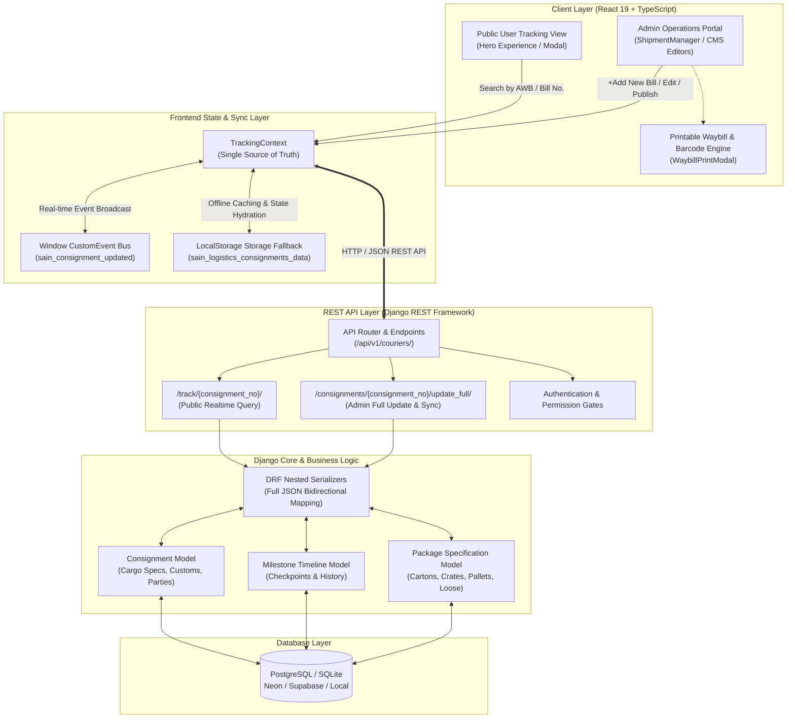

# ✈️ SAIN International Logistics — Enterprise Freight & Consignment Tracking Suite

<div align="center">


**An enterprise-grade cross-border freight forwarding, real-time cargo tracking, and logistics operations platform.**  
Connecting Guangzhou/Global Air-Sea Terminals directly to Bangladesh Doorstep delivery.

[](https://react.dev/)
[](https://www.typescriptlang.org/)
[](https://www.djangoproject.com/)
[](https://www.django-rest-framework.org/)
[](https://tailwindcss.com/)
[](https://vitejs.dev/)
[](https://www.python.org/)
[](#)

[Features](#-key-features) •
[Architecture](#-system-architecture) •
[Tech Stack](#-tech-stack) •
[Data Flow](#-real-time-synchronization-workflow) •
[API Reference](#-rest-api-reference) •
[Quick Start](#-installation--setup) •
[Admin Portal](#-admin-management-portal)

</div>

---

## 📌 Executive Overview

**SAIN International Logistics** is a modern, full-stack logistics management platform architected for international freight forwarders, cargo consolidators, and supply chain operators.

It bridges the operational gap between origin cargo warehouses (e.g. Guangzhou Baiyun Terminal [CAN]) and destination clearance hubs (e.g. Hazrat Shahjalal International Airport Customs House [DAC]), offering real-time visibility, automated waybill generation, regulatory compliance under the **Bangladesh Customs Act 2023**, and an administrative management suite.

---

## 🏗️ System Architecture



---

## ⚡ Key Features

### 1. 🔍 Live Consignment Tracking Engine
- **Unified Consignment Lookup**: Instant query by Consignment Code, Reference Number, or Air Waybill number (`SAINEX067638406`, `12345`, `SAIN-78492-BD`, `SAIN-SEA-99120`).
- **Transit Corridor Visualization**: Visual progress connecting Origin Hubs (e.g. `[CAN] Guangzhou, China`) to Destination Hubs (e.g. `[DAC] Dhaka, Bangladesh`).
- **Dynamic Milestone Timeline**: Clear progression markers for Completed, In-Flight, and Pending checkpoints with audit timestamps and geographic tags.
- **Cargo Specification Breakdown**: Detailed display of Gross Weight, Carton Count, Volume (CBM), Payment Mode, HS Codes, and Dimensions.
- **Statutory Customs Compliance**: Live assessment badge under the **Bangladesh Customs Act 2023**, trade terms (DAP/CFR), and assessment stations.

### 2. 🛠️ Enterprise Admin Portal (`/admin`)
- **Complete Consignment Lifecycle Management**: Add, modify, publish, archive, or trash consignments.
- **`+ Add New Bill` Generator**: Generates an auto-incremented, collision-checked unique consignment code starting with **`SAINEX` + 8 digits** (e.g., `SAINEX58291402`), resetting all fields to a clean state ready for entry.
- **10-Checkpoint Milestone Pagination**: Shipment history checkpoints table paginated to **10 records per page** with interactive `[Prev] [1] [2] ... [Next]` navigation controls.
- **Standardized Package Piece Types**:
  - `-- Select Type --`
  - `Pallet`
  - `Carton`
  - `Crate`
  - `Loose`
  - `Others`
- **10 Authorized Consignment Statuses**:
  | Status | Color Badge | Meaning |
  | :--- | :--- | :--- |
  | `Pending` | Indigo / Purple | Consignment booked, pending terminal handover |
  | `Received` | Indigo / Purple | Received at origin hub terminal |
  | `On Hold by Customs` | Orange Pulse | Inspection hold at customs house |
  | `Out for delivery` | Amber Pulse | Dispatched on last-mile delivery vehicle |
  | `In Transit` | Blue | Moving across international corridor |
  | `Enroute` | Blue | In flight or ocean voyage underway |
  | `Cancelled` | Red / Rose | Booking terminated |
  | `Delivered` | Emerald Green | Successfully delivered to consignee |
  | `Returned` | Red / Rose | Returned to hub or shipper |
  | `At Bangladesh warehouse` | Teal / Cyan | Staged at local Dhaka warehouse |

### 3. 🖨️ Printable Air Waybill (AWB) & Invoice Generator
- Dedicated modal rendering an official **International Air Waybill (HAWB)** conforming to IATA layout principles.
- Code 128 barcode simulation, carrier stamps, signature zones, and billing itemization.
- Integrated print stylesheet (`@media print`) stripping out browser chrome, buttons, and navigation for crisp, physical printing.

### 4. 📝 Integrated Content Management System (CMS)
- **Home Content Editor**: Hero banners, key metrics counters, promotional notices.
- **About Us Editor**: Company profile, operational history, core leadership values.
- **Services Catalog Editor**: Air freight, ocean freight, warehousing, and customs clearance cards with pricing matrices.
- **Branch Directory Editor**: Guangzhou Hub, Dhaka Corporate Office, Chittagong Port Liaison, phone numbers, and operational hours.
- **Admin Profile Editor**: Secure credential manager for modifying administrative login parameters.

### 5. 🔄 Dual-Tier Resilient Data Synchronization
- **Primary Tier**: Django REST Framework backend with SQLite/PostgreSQL persistence.
- **Secondary Tier**: Browser `LocalStorage` caching with optimistic UI updates.
- **Real-Time Broadcast**: `window.dispatchEvent(new CustomEvent('sain_consignment_updated'))` propagates updates across active browser tabs and modal views without page refresh.

---

## 💻 Tech Stack

### Frontend Architecture
| Technology | Version | Purpose |
| :--- | :--- | :--- |
| **React** | `19.0.1` | Declarative UI component architecture |
| **TypeScript** | `5.x / 7.x` | Strict end-to-end type safety |
| **Tailwind CSS** | `v4.3.3` | Modern utility-first responsive styling system |
| **Vite** | `8.3.0` | Ultra-fast build tool and Hot Module Replacement |
| **Lucide React** | `^0.546.0` | Enterprise iconography suite |
| **Motion** | `^12.23.24` | Smooth transitions and state animations |

### Backend Architecture
| Technology | Version | Purpose |
| :--- | :--- | :--- |
| **Python** | `3.12+` | Runtime environment |
| **Django** | `5.x` | Enterprise web framework |
| **Django REST Framework** | `3.15+` | High-throughput REST API serializer and views |
| **django-cors-headers** | `4.3.1` | Cross-Origin Resource Sharing handling for dev & prod |
| **dj-database-url** | `2.1.0` | 12-factor cloud database URL configuration |
| **SQLite / PostgreSQL** | `3 / 15+` | Relational data persistence with foreign-key cascade integrity |

---

## 📡 REST API Reference

Base URL: `http://127.0.0.1:8000/api/v1/couriers/`

### 1. Public Tracking Endpoint
```http
GET /api/v1/couriers/track/{consignment_no}/
```
- **Description**: Public endpoint returning complete milestone history, carrier details, package counts, and customs status.
- **Response**: `200 OK`
```json
{
  "consignment_no": "SAINEX067638406",
  "reference_no": "CRN-884920",
  "status": "At Bangladesh warehouse",
  "service_type": "Air Freight Priority",
  "carrier": "SAINEX",
  "origin_city": "Guangzhou",
  "origin_code": "CAN",
  "destination_city": "Dhaka",
  "destination_code": "DAC",
  "receiver_name": "Muhammad Tahin",
  "receiver_phone": "+8801731939325",
  "packages_count": "7",
  "weight_text": "around 1500g",
  "progress_percentage": 75,
  "milestones": [
    {
      "id": 1,
      "date_str": "2026-08-01",
      "time_str": "19:47 pm",
      "location": "China",
      "status": "Received",
      "remarks": "Terminal check-in completed"
    },
    {
      "id": 2,
      "date_str": "2026-08-11",
      "time_str": "13:46 pm",
      "location": "Bangladesh",
      "status": "At Bangladesh warehouse",
      "remarks": "Inward gate entry completed"
    }
  ]
}
```

### 2. List All Consignments
```http
GET /api/v1/couriers/consignments/
```
- **Description**: Returns all registered active shipments.

### 3. Full Consignment Update
```http
PUT /api/v1/couriers/consignments/{consignment_no}/update_full/
```
- **Description**: Atomically updates consignment metadata, replaces packages, and inserts sequential milestone timeline entries.
- **Body**: JSON payload with `status`, `packages_data`, `milestones`, `receiver`, and `admin_metadata`.

---

## 📂 Directory Structure

```text
sain-international-logistics/
├── Backend/                            # Django Backend Application
│   ├── api/                            # API router configuration
│   ├── core/                           # Core utilities & base models
│   ├── couriers/                       # Logistics Engine (Consignments, Milestones, Packages)
│   │   ├── migrations/                 # Schema migrations
│   │   ├── models.py                   # Consignment & Milestone models
│   │   ├── serializers.py              # DRF serializers
│   │   ├── views.py                    # REST views & tracking endpoints
│   │   └── urls.py                     # App routing
│   ├── order/                          # Commercial orders & billing
│   ├── products/                       # Cargo product classifications
│   ├── users/                          # User accounts & admin authentication
│   ├── sain/                           # Django project root (settings.py, urls.py, wsgi.py)
│   ├── db.sqlite3                      # Local relational database
│   ├── manage.py                       # Django CLI tool
│   └── requirements.txt                # Python dependencies
│
├── Frontend/                           # React 19 + TypeScript Application
│   ├── Context/
│   │   └── TrackingContext.tsx         # Central state manager & real-time sync
│   ├── Layouts/
│   │   └── MainLayout.tsx              # Public site frame & modal mounting
│   ├── components/
│   │   ├── admin/                      # Enterprise Admin Portal Components
│   │   │   ├── AboutContentEditor.tsx
│   │   │   ├── AdminLogin.tsx
│   │   │   ├── AdminProfileEditor.tsx
│   │   │   ├── AdminSidebar.tsx
│   │   │   ├── ContactContentEditor.tsx
│   │   │   ├── HomeContentEditor.tsx
│   │   │   ├── ServicesContentEditor.tsx
│   │   │   ├── ShipmentManager.tsx     # Consignment management workstation
│   │   │   └── WaybillPrintModal.tsx   # Printable AWB & Invoice layout
│   │   ├── HeroTrackingExperience.tsx  # Dynamic hero search widget
│   │   ├── Navbar.tsx                  # Public header with admin portal link
│   │   ├── ServicesSection.tsx         # Logistics services catalog
│   │   ├── TrackingModal.tsx           # Fullscreen interactive tracking modal
│   │   └── TrackingSection.tsx         # Standalone tracking card
│   ├── pages/
│   │   ├── AdminPage.tsx               # Admin authentication & shell controller
│   │   ├── HomePage.tsx                # Public landing page
│   │   └── ServicesPage.tsx            # Dedicated services breakdown
│   ├── services/
│   │   └── trackingData.ts             # Initial consignments, types & status helpers
│   ├── App.tsx                         # Client router & tab navigation
│   └── index.css                       # Tailwind CSS rules & print styles
│
├── package.json                        # Frontend dependencies & npm scripts
└── README.md                           # Master architectural documentation
```

---

## 🚀 Installation & Setup

### Prerequisites
- **Node.js**: `v18.x` or higher
- **Python**: `v3.10` or higher
- **Git**

---

### Step 1: Clone Repository
```bash
git clone https://github.com/SayhamKayes/SKz-Logistics.git
cd SKz-Logistics
```

---

### Step 2: Backend Setup (Django)
```bash
# Navigate to Backend folder
cd Backend

# Create and activate Python virtual environment
python -m venv venv
# Windows (PowerShell):
.\venv\Scripts\Activate.ps1
# macOS/Linux:
source venv/bin/activate

# Install dependencies
pip install -r requirements.txt

# Run database migrations
python manage.py migrate

# (Optional) Create superuser
python manage.py createsuperuser

# Start the Django API server
python manage.py runserver 8000
```
> The API will be active at `http://127.0.0.1:8000/api/v1/couriers/`

---

### Step 3: Frontend Setup (React + Vite)
In a new terminal window:
```bash
# From repository root
npm install

# Start the Vite development server
npm run dev
```
> The web application will launch at `http://localhost:3000`

---

## 🔑 Default Credentials & Quick Test Data

### Admin Portal Credentials
- **URL**: Navigate to the top navbar and click **Admin Portal** or append `admin` view.
- **Username**: `sain_sakib6055`
- **Password**: `password123`

### Sample Tracking Numbers for Testing
| Tracking Code | Type | Corridor | Packages |
| :--- | :--- | :--- | :--- |
| **`SAINEX067638406`** | Priority Air Freight | Guangzhou (CAN) → Dhaka (DAC) | 7 Cartons |
| **`12345`** | Express Courier | Guangzhou Hub → Dhaka Doorstep | 1 Box |
| **`SAIN-78492-BD`** | Commercial Freight | China → Bangladesh | 5 Crates |
| **`SAIN-SEA-99120`** | Ocean FCL Vessel | Ningbo Port → Chittagong Port | 2 Pallets |

---

## 📜 Bangladesh Customs Act 2023 Compliance

The platform includes built-in compliance tracking with the **Bangladesh Customs Act 2023**:
- **Statutory Framework**: Formulated according to National Board of Revenue (NBR) digital customs guidelines.
- **Incoterms Support**: Full documentation for `DAP` (Delivered at Place), `CFR` (Cost & Freight), and `FOB` (Free on Board).
- **Customs Stations**: Pre-linked with Hazrat Shahjalal International Airport (HSIA), Chittagong Sea Port, and Kamalapur ICD.

---

## 👨‍💻 Author & Engineering Credits

- **Lead Engineer & Architect**: **[Sayham Kayes](https://github.com/SayhamKayes)**
- **Organization**: SAIN International Logistics
- **Repository**: [SayhamKayes/SKz-Logistics](https://github.com/SayhamKayes/SKz-Logistics.git)

---

<div align="center">
  <sub>Built with ❤️ for high-performance international air & ocean freight forwarding.</sub>
</div>
